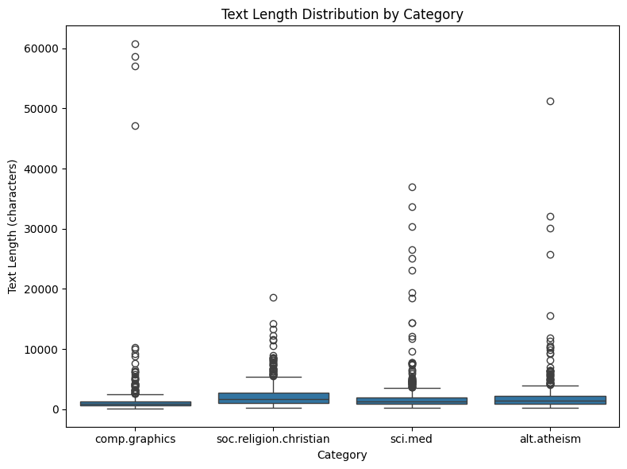
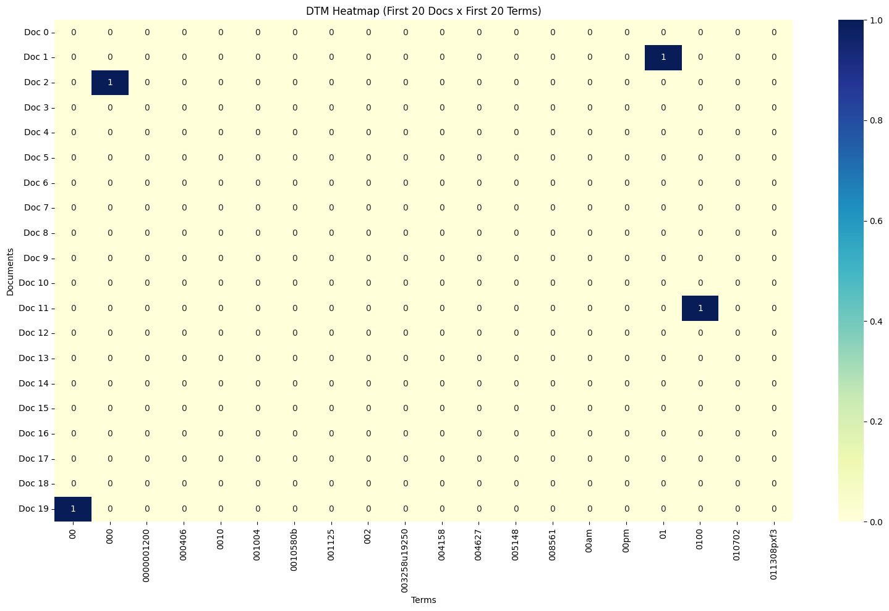
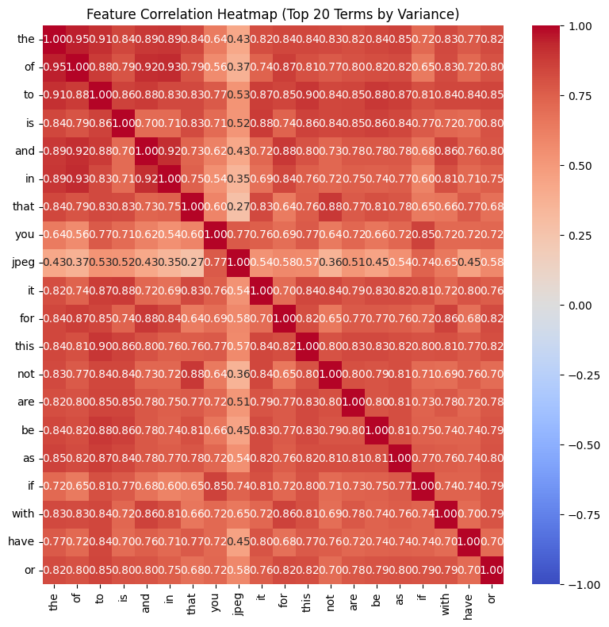
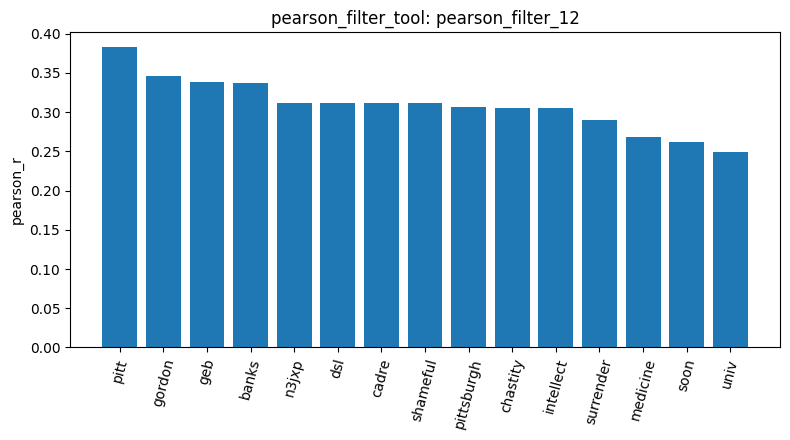
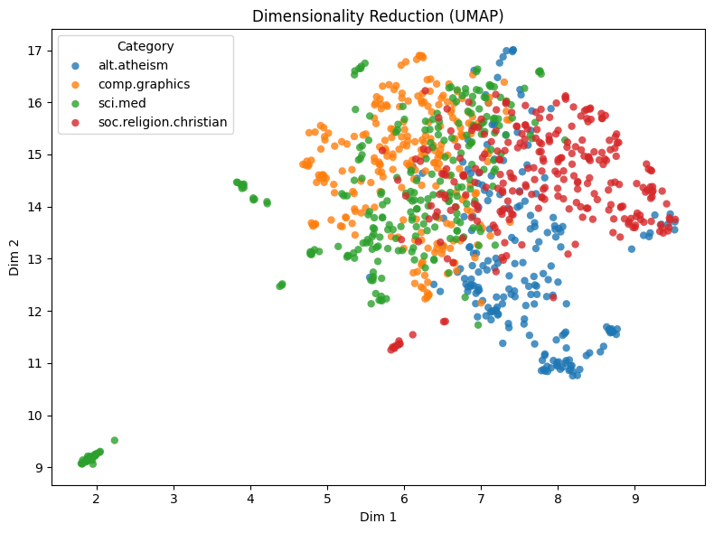
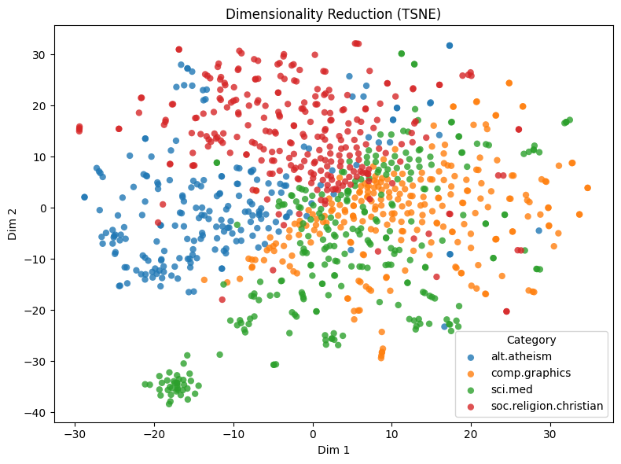
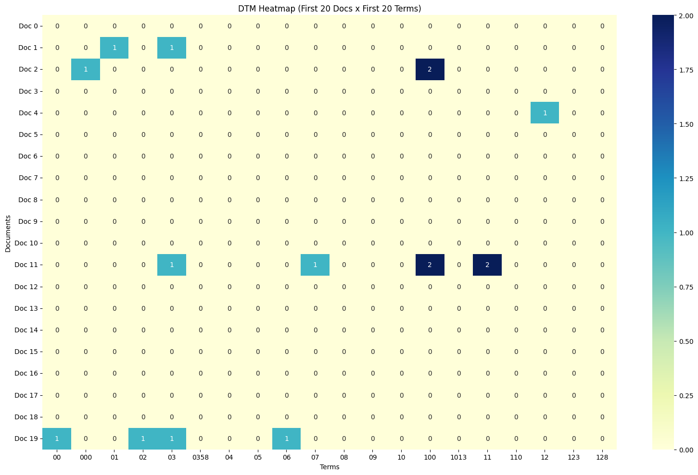
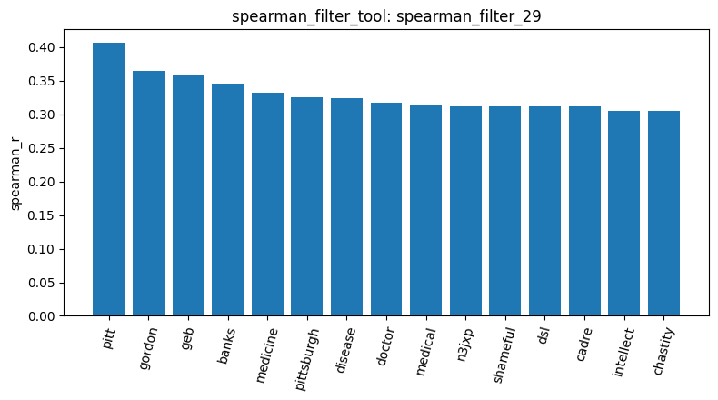

# Agentic pipeline report: 20 Newsgroups

## 1. Data loading and quality checks
I loaded the 20 Newsgroups corpus with four categories (`load_dataset_1`) for a total of 2,257 posts (soc.religion.christian 599, sci.med 594, comp.graphics 584, alt.atheism 480). In `inspect_data_2` i saw that the posts still have their raw email headers (From, Subject, Organization, Lines). `check_missing_3` and `check_duplicates_4` found no empty and no duplicate posts. `describe_data_5` showed that post lengths are very uneven like the median is 1,235 characters, the mean is 1,993 and the maximum is 60,713 (comp.graphics). So a few very long posts could weigh a lot in raw word counts.

## 2. Sample and first document-term matrix
I took a random sample of 1,000 posts with `random_state=42` (`sample_data_6`). In `describe_data_7` the category sizes stay close to the full data with alt.atheism 206, comp.graphics 247, sci.med 277, soc.religion.christian 270. And the shifts are between about -1.2 and +1.4 percentage points, so I kept the sample.

`build_dtm_8` gave a matrix of 1,000 posts by 22,538 terms, with 99.29% zeros. In `term_frequency_9` (304,295 words in total) but the major part of the top terms are stop words like the (13,284), to, of, is, and. The heatmap `dtm_heatmap_10` is almost all zeros, and there are two reasons for that. First, the tool only shows the first 20 posts and the first 20 terms in alphabetical order, and these terms are mostly numbers like `0000001200` and second, the matrix is also very sparse overall.

## 3. Filtering on build_dtm_8
`variance_filter_11` (threshold 0.01 advised by the agent) kept 4,759 of 22,538 terms. It removes rare terms but not stop words. In `feature_corr_14`, the 20 terms with the highest variance are almost all stop words (the, of, to, is, and...). They are strongly correlated with each other (the/of 0.947, the/to 0.910, the/you 0.636), probably because all of them grow with the length of a post. "jpeg" is the only topical word in the list, and it is less correlated with "the" (0.429).

`pearson_filter_12` (with target sci.med and threshold 0.1) kept 476 terms and `spearman_filter_13` kept 595. The lists returned by the tool are alphabetical, so I looked at the bar chart of `pearson_filter_12` and most top terms are not medical like pitt, gordon, geb, banks, n3jxp, dsl, cadre, shameful, chastity, intellect. Only "medicine" is related to the topic. They look like the signature of one very active author in sci.med. A term that appears in many sci.med posts and rarely elsewhere gets a high correlation, whatever it means.

## 4. Stop words
I rebuilt the matrix with `stop_words="english"` (`build_dtm_15`) and it gives 22,235 terms, and the total word count went from 304,295 to 164,405 (`term_frequency_16`). The top terms are now header words: edu (1,957), subject (1,110), lines (1,034), organization (966)... Only "god" (1,018) and a few others are real content. So stop-word removal did not clean the headers. `spearman_filter_17` (sci.med, threshold 0.1) kept 591 terms, almost the same as the 595 before.

## 5. Dimension reduction, labels and cosine similarity
On `build_dtm_15` I ran UMAP with `random_state=42` (`reduce_dimensions_19`) and t-SNE (`reduce_dimensions_20`). In the UMAP plot (`reduce_dimensions_19`) the four categories are only partly separated. comp.graphics is mostly at the top left, soc.religion.christian on the right and alt.atheism at the bottom, but sci.med overlaps a lot with comp.graphics in the middle. In the t-SNE plot (`reduce_dimensions_20`) alt.atheism is on the left, soc.religion.christian at the top and comp.graphics in the middle and on the right. Both plots also show a small tight group of sci.med posts far from the rest (bottom left).

`binarize_labels_21` turned the labels into 4 binary columns. The correlation filters do not use this output, they build their own 0/1 vector for the target class.

I then compared three pairs of posts with cosine similarity: documents 0 and 2 (both sci.med), 0 and 1 (sci.med and soc.religion.christian), and 1 and 3 (both soc.religion.christian). All scores are low, and the same-category pairs are only a little higher than the cross-category pair.

## 6. Removing header words with max_df and min_df
I asked the agent if `max_df` and `min_df` could remove the header words. It suggested `max_df=0.5` and `min_df=5`. The agent also said header words are in 80-95% of the posts. `min_df=5` failed because my `build_dtm_tool` types `min_df` as a float, so 5 became 5.0 and scikit-learn rejected it. I used `min_df=0.005` instead, which means at least 5 posts out of 1,000.

`build_dtm_25` has 4,392 terms (from 22,235 before) and 98.16% zeros. The number of non-zero entries only went from 113,097 to 80,715, so most removed terms were rare ones. In `term_frequency_26`, edu, subject, lines, organization and writes are gone from the top. This means they were in more than half of the posts. But com, article, university and posting are still there, and they also look like header words. "god" is still at 1,018.

`dtm_heatmap_27` has more non-zero cells than `dtm_heatmap_10`, because the rare number tokens are gone. `variance_filter_28` (threshold 0.01) kept 3,274 of 4,392 terms, against 4,759 of 22,538 (21%) in `variance_filter_11`. The rare terms were already removed by `min_df`, so the threshold removes much less now.

`spearman_filter_29` (sci.med, threshold 0.1) kept 442 of 4,392 terms (10%), against 591 of 22,235 (2.7%) in `spearman_filter_17`. The bar chart, created after `spearman_filter_29` has 15 terms: pitt, gordon, geb, banks, medicine, pittsburgh, disease, doctor, medical, n3jxp, shameful, dsl, cadre, intellect, chastity. Four are clearly medical (medicine, disease, doctor, medical), against one in the Pearson chart. But the signature words are still there.`min_df` and `max_df` only look at how many posts contain a word, not where it comes from. So we can see that a signature that appears in many sci.med posts, but not in half of all posts, passes both limits.

I ran cosine similarity on the same three pairs of posts with `build_dtm_25`. The two same-category pairs went from 0.0739 to 0.0709 (documents 0 and 2) and from 0.0751 to 0.0627 (documents 1 and 3). The cross-category pair (documents 0 and 1) dropped much more, from 0.0655 to 0.0377. So the gap between same and different categories grew from about 0.009 to 0.029, and removing header and rare words helped the categories to separate a bit.

## 7. Pattern mining
`mine_patterns_18` (sci.med, tf-idf, top-k, k=20) returned only header words: subject (support 277, which is all sci.med posts in the sample), lines (271), organization (269), edu, and combinations of them. The agent had said tf-idf would isolate medical words, and this result shows it did not.

The tool builds its own matrix for the category (only stop words removed), so my `max_df` and `min_df` have no effect here. In the code, `term_frequency` removes the 5% most frequent and the 5% least frequent terms. With it (`mine_patterns_31`, top-k, k=20) the header words are gone, but the 20 patterns are single generic words with support 13 to 16 out of 277 posts: greatly, means, pretty, didn, nose, treating, bitnet. Most medical words were probably removed with the frequent ones.

With `maxfpgrowth` and `min_sup=5` (`mine_patterns_32`) the agent reported 914 patterns, all with support 5 in the part I saw. There are some medical words (surgeon, headache, quacks) but also groups that look like names and email signatures, like "baff ella romdas uclink" or "richard silver rsilver".

## 8. Conclusion and limits
Words that are in almost every post (edu, subject, lines, organization) and very rare words can be removed with `max_df` and `min_df`. But noise that is frequent inside one category, like the signature of an active author, were difficult to remove. It stays in the correlation filters and in the pattern mining, whatever the filter or the algorithm. A good fix would be to clean the posts before building the matrix, for example by removing headers, footers and quotes when loading the data.

My biggest limit was to only use one sample of 1,000 posts. I took it once with `random_state=42` (`sample_data_6`) out of the 2,257 posts, and every later step used only these posts. The sample is not stratified, and the category shares moved by about one point, for example sci.med went from 26.3% to 27.7%. That is small, but I did not try another seed or the full data, so I do not know how much the results would change. This matters most for the cosine scores, because they come from three pairs of posts that were all picked from the start of the sample. A different sample could give different numbers, even if I think the general picture would stay the same.