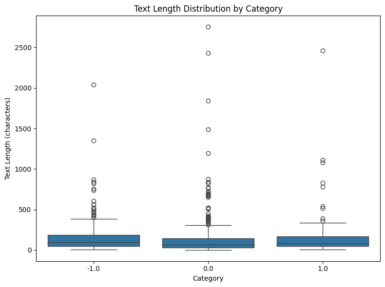
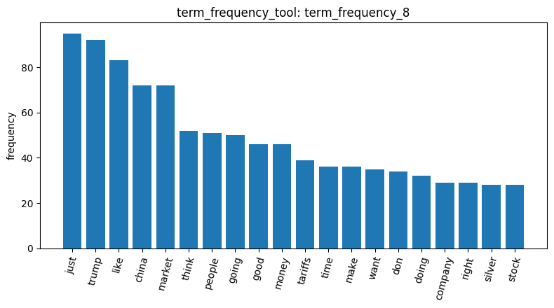
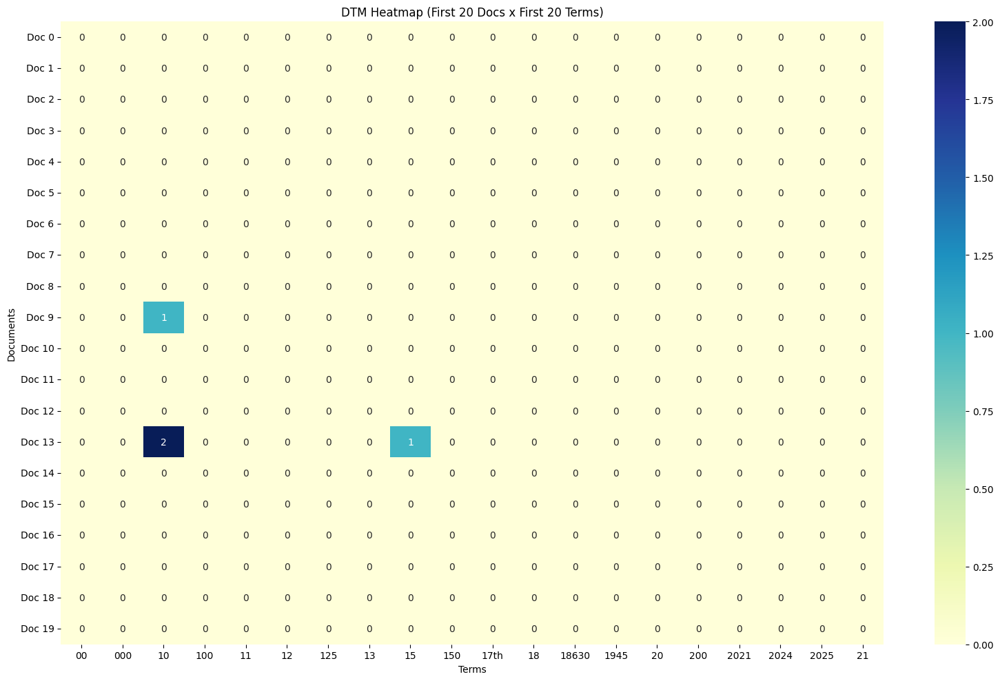
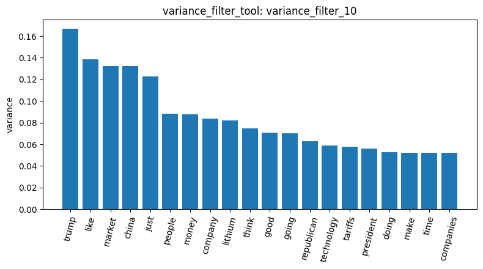
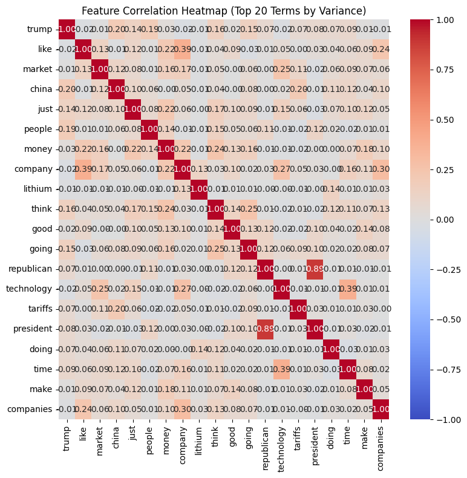
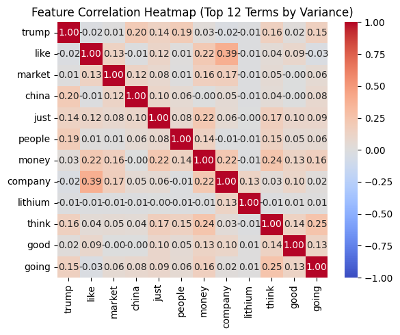
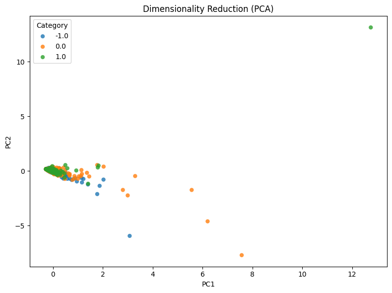
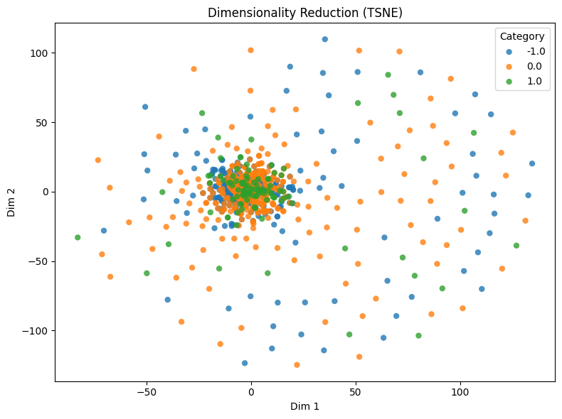
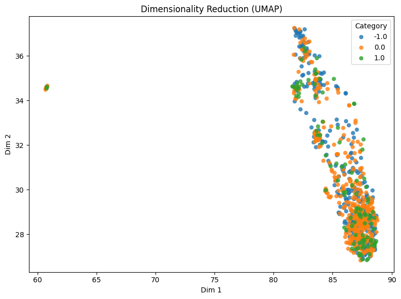

# Homework report: Reddit stock sentiment

## 1. Data loading and quality checks
I loaded the Reddit stock sentiment file (`load_dataset_1`) for a total of 847 posts, label 0.0 has 423 posts, -1.0 has 315 and 1.0 has 109, for neutral, negative and positive. In `inspect_data_2` I saw that the posts are very short and informal, like "Calls on retards" or "He didn't say thank you.". `check_missing_3` found no empty post, and `check_duplicates_4` found 34 duplicate posts (4.01%). I dropped them with `check_duplicates_5`, but the tool uses `keep=False`, so all the copies were removed, including the first one, and the dataset went from 847 to 813 posts (315 negative, 391 neutral and 107 positive). `describe_data_6` showed that post lengths are very uneven, like the median is 80 characters, the mean is 148 and the maximum is 2,753 (neutral). The three classes have a similar length, so the length does not help to guess the sentiment. And the positive class is small (107 posts out of 813), so the results on it will be less reliable.

## 2. Sampling and document-term matrix
I asked the agent if I should sample the dataset. It advised not to, for two reasons: 813 posts is already a small dataset that the tools can process very fast, and sampling would reduce the positive class even more, which would make the results on this class even less reliable. I agreed with this argument, so I kept all the posts and did not use `sample_data_tool`.

To build the document-term matrix, I asked the agent for its recommended parameters and then ran `build_dtm_7` with `stop_words="english"`, `max_df=0.8`, unigrams only and `min_df=0.002`, which means that a word must appear in at least 2 posts. The final matrix has 813 posts and 1,441 terms, with 6,875 non-zero values and 99.41% zeros, which is about 8.5 terms per post. The parameter `max_df=0.8` changed almost nothing, because in such short posts no word appears in 80% of the documents.

I also asked the agent if removing the English stop words could be a problem for sentiment analysis. It answered that it can, because words like "not" and "no" are in the list, so "not good" becomes "good" and the meaning is reversed. In addition, the tokenizer cuts "don't" into "don" and throws away the "t", which is why "don" appears in the most frequent terms. The agent also proposed tokens like "not_buy", but the tool does not create tokens like this, so this part of its answer was not correct.

## 3. Term frequency and heatmap
With `term_frequency_8` (7,624 words in total), I looked at the most frequent terms. The top of the list is just (95), trump (92), like (83), china (72) and market (72), followed by think, people, going, good and money (46). Many of these words are about politics and trade (trump, china, tariffs), which means that the dataset talks more about the news than about trading itself. There is no stock ticker in the top 20. We can also see some filler words that are not in the stop word list (just, like, going, doing), so the English stop word list did not remove them. Finally, "good" is the only word with a clear sentiment, but without the word "not" before it we cannot know if the post is positive or negative.

The heatmap `dtm_heatmap_9` is almost entirely made of zeros. The reason is that the tool shows only the first 20 posts and the first 20 terms in alphabetical order, and in this dataset these terms are numbers (00, 000, 10, 100, ... 2025). Only three cells are not zero: the term "10" in posts 9 and 13, and the term "15" in post 13. So this view does not say anything about the real vocabulary of the posts. I asked the agent if there was a better way to look at the matrix, and it agreed with my remark and advised the bar chart of the most frequent terms, which I created with `visualize_result_tool`.

## 4. Filters
The agent recommended a variance filter, so I ran `variance_filter_10` with a threshold of 0.01 and it kepts 286 terms out of 1,441. With a threshold of 0.01, a term that is mostly 0 or 1 needs about 9 occurrences in the dataset to be kept. This means that the variance filter acts mainly as a frequency filter. For example, it keeps "00", "000", "10", "12" and "15" and removes "2021", "2024" and "2025" only because they are more rare. It also does not remove the filler words, because they are frequent.

Next, I used the two correlation filters with the positive class as target (`target_class="1.0"`), a threshold of 0.05 and `abs_value=True`. `pearson_filter_11` kept 261 terms and `spearman_filter_12` kept 259 terms. The two results are almost the same, and this is what we can expect here: the target is a vector of 0 and 1, and the word counts are also mostly 0 or 1, so the linear correlation and the rank correlation give very close values. Only the word "ai" appears in the Pearson sample and not in the Spearman one. The agent explained this difference with ties in the ranks, but the tool does not return the coefficients, so this explanation is only a guess.

The correlation filters also select very different terms from the variance filter. For example, Pearson removes "00", "000", "10", "12" and "15", which the variance filter kept, and it keeps "100", "18", "2021", "42" and "98", together with some finance words such as "amd", "amzn", "acquisition" and "approved". In my opinion, the threshold of 0.05 was too low for this dataset because it still keeps 261 of the 1,441 terms, and many of them are rare.

## 5. Feature correlation
I ran `feature_correlation_matrix_tool` with the 20 terms of highest variance (`feature_corr_13`), but the plot was hard to read, so I ran it again with 12 terms (`feature_corr_14`). We can see that the top 20 terms by variance are not the same as the top 20 by frequency: "lithium", "republican", "technology" and "president" are in the first list but not in the second one. When I asked the agent why, it explained that these words are repeated many times in a small number of posts, and this increases their variance even if their total count is low. This seems correct to me, because "lithium" has at most 28 occurrences in the whole dataset but a variance of about 0.08, which is not possible if it appears only once per post.

The strongest correlation is between "republican" and "president" (0.888). All the other correlations are under 0.5 such as like/company 0.389, technology/time 0.386, company/companies 0.302, think/going 0.252 and trump/china 0.198. There is no stop word in this list, so we do not find correlations like the/of that we had in the 20 newsgroups report. In general, the correlations are low because the posts are short, and two words rarely appear together in the same post.

## 6. Pattern mining
For the pattern mining I chose the positive class (107 posts), the algorithm `fpgrowth` and the tf-idf filtering method. With `min_sup=5` (`mine_patterns_15`), the tool found 16 patterns, and all of them are single words: just (15), good (12), doing (9), like and going (8), then economy, time and way (6), and better, market, tariffs and a few others. So there is no pair of words that appears together in at least 5 positive posts. The agent explained this result by the fact that the posts are short and talk about many different things, and I agree with this.

Because of this, I lowered the minimum support to 3 (`mine_patterns_16`) and the tool found 87 patterns. However, it only shows the first 50 patterns and they are not sorted, so the multi-word patterns that the agent listed come only from these 50. The multi-word patterns are "main", "points" and "just" together, "tldr" with "technology", and "long term". "Main points" and "tldr" look more like the format of one type of post than a positive opinion. The new single words are closer to investing (buy, invest, dividend, hold, trade).

The agent said that tf-idf "highlights category-informative terms", but I do not think this is true here, because most patterns are filler words like "just", "doing" and "like". Also, "trump" and "china" are not in the positive patterns at `min_sup=5`, so they are in fewer than 5 positive posts or the filter removed them.

## 7. Dimension reduction and labels
I applied three methods on `build_dtm_7`, all with `random_state=42`: PCA (`reduce_dimensions_17`), t-SNE with a perplexity of 30 (`reduce_dimensions_18`) and UMAP with 15 neighbors (`reduce_dimensions_19`). The first two components of the PCA explain only 4.35% and 3.56% of the variance, which is 7.90% in total, so a 2D plot keeps very little of the information. In the PCA plot, most of the posts are in one dense cloud near (0, 0) with the three classes mixed together, and a few posts are very far from the others, for example one positive post at about (12.7, 13.1). Since the PCA is made on raw counts, I think the axes follow the posts that contain many repeated terms. In the t-SNE plot we see a dense core with a ring of scattered posts around it, and again the three classes are mixed everywhere. In the UMAP plot the posts form a long band with all the classes mixed, and there is a small isolated group on the left. I think that this group may be posts that are almost the same, maybe from a repeated template, but the tool cannot confirm it.

To sum up, none of the three methods separates the negative, neutral and positive posts. This is different from the 20 newsgroups report, where the categories were at least partly separated.

After that, I asked the agent what we could try to improve the separation. It suggested tf-idf weights, filtering the terms with Pearson or Spearman before the reduction, sentiment lexicons, and bigrams with the negations kept. However, not all of these ideas are possible here. The correlation filters do not change the matrix used by `reduce_dimensions_tool`, and choosing the terms with the labels before looking at the classes would be circular, because the labels would already be inside the features. In addition, none of my tools gives lexicon scores. The most realistic idea with my tools is to rebuild the matrix with `ngram_range=[1, 2]`.

I also ran `binarize_labels_tool` (`binarize_labels_20`). It gives a matrix of 813 rows and 3 columns, one for each class (-1.0, 0.0 and 1.0), so for example document 0 (-1.0) is [1, 0, 0]. The correlation filters do not use this output, because they build their own 0/1 vector for the target class.

Finally, I compared document 0 (negative) with document 2 (neutral) in `cosine_similarity_21`, and with document 1 (neutral) in `cosine_similarity_22`. Both scores are 0.0, which means that these posts share no term in the matrix. This is not a surprise, because the posts are very short and the matrix has only 1,441 terms, so two posts rarely have a word in common. 

## 8. Conclusion and limits
In conclusion, a bag-of-words representation does not tell the sentiment on this Reddit dataset. The posts are very short (about 8 terms per post), the most frequent words are about politics and trade, the filters keep many rare terms, and the patterns are mostly filler words or the format of a repeated post. As a result, the three classes overlap in PCA, t-SNE and UMAP. Compared to the 20 newsgroups report, where the topics have different vocabularies, here the sentiment is carried by small words and negations.

My work has several limits. First, the positive class has only 107 posts, so every result about it is fragile. Second, I used a low minimum support (3) and a low correlation threshold (0.05), which may keep patterns and terms that appear only by chance. And finally, the tools show only 50 patterns and alphabetical samples of the filtered terms, so I could not check the complete lists.